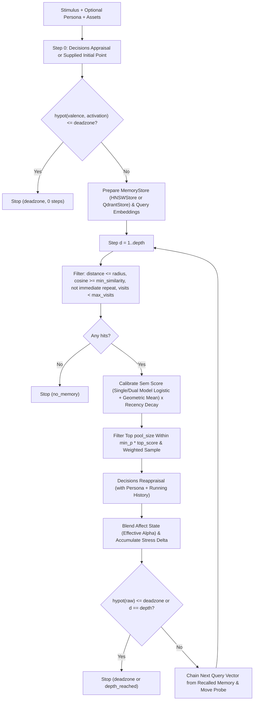

# braingate

`braingate` (`github.com/snowmerak/braingate`) is an affect-gated associative memory recall engine written in Go. It pairs structured affective appraisal through [`github.com/snowmerak/decisions`](https://github.com/snowmerak/decisions) with dense vector search over a 2D `(Valence, Activation)` affect plane to model how emotion shapes what comes to mind and how recalled memories shift emotion over multi-step rumination.

## The Idea

Standard retrieval-augmented generation retrieves memories purely by semantic similarity: given the same prompt text, an agent in acute panic and an agent in calm focus surface the exact same memories. Conversely, static associative memory graphs require brittle hand-authored edges that break when encountering unseen situations.

`braingate` replaces static edges with **dynamic descent over a continuous 2D `(Valence, Activation)` plane** in `[-1, 1] × [-1, 1]`:

1. **Appraisal precedes recall**: A stimulus (and optional persona) first produces an immediate emotional coordinate before any memory is searched.
2. **Mood sets reachability, not semantic bias**: Current affect defines a circular reachability radius (`radius`) around the probe coordinate. Only memories within that affective neighborhood can be recalled, while semantic relevance decides ranking among reachable memories without penalizing entries near the boundary.
3. **Recalled memories pull emotion and chain forward**: Each retrieved memory is re-appraised in light of the stimulus, persona, and running state, shifting cumulative affect (`valence`, `activation`), accumulating emotional `stress`, and replacing the next step's vector query with the recalled memory itself so associations chain naturally (`stimulus → memory A → memory B → ...`).
4. **Neutral settling short-circuits rumination**: If either the initial reaction or a post-step emotional probe enters a configurable `deadzone` around `(0, 0)`, recall stops early instead of forcing fixed-depth retrieval.

## Purpose & Output

`braingate` does not generate conversational prose itself. It acts as the **pre-response cognitive and affective layer** for stateful agents, NPCs, or character simulations.

Given an input stimulus (with optional conversational context, image assets, persona, initial mood override, timestamp, and PRNG seed), `Engine.Run` returns a structured `Result` containing:

- **Ordered recall trajectory (`steps`)**: Each recalled memory's ID, candidate `pool`, visit count, affect `distance`, primary and optional secondary cosine `similarity`, recency `decay`, calibrated `score`, effective blending rate `alpha`, unblended `raw` reading, and post-blend `state`.
- **Final emotional state & cumulative stress (`final`)**: Resulting `valence` and `activation` in `[-1, 1]`, accumulated `stress` (sum of Euclidean affect-state movements across steps), completed step count, and `stop_reason` (`deadzone`, `depth_reached`, or `no_memory`).
- **Baseline appraisal (`initial`)**: Starting coordinate and decision confidences (`evaluated` or caller-`supplied`).

## How It Works



### 1. Strict Separation of `Persona`, `Temperament`, and `Memories`

- **`Persona`**: Natural-language disposition text injected **only** into `decisions` requests (`initialQuestions` and `memoryQuestions`). It is isolated from embedding inputs so personality framing shapes how events are interpreted without distorting factual semantic retrieval.
- **`Temperament`**: Numeric parameters controlling recall depth, blending rate, deadzone threshold, affective reachability, similarity floor, sampling behavior, and memory forgetting.
- **`Memories`**: Experiences positioned on `[-1, 1] × [-1, 1]` with `id`, optional `cue`, `experience`, optional per-memory `alpha`, `salience` (`[0, 1]`), `created_at`, and optional precomputed `embedding` and `secondary_embedding` vectors.

### 2. Initial Appraisal & Deadzone Exit

Unless `RunOptions.Initial` is provided, Step 0 calls `decisions.Client.Evaluate` on two 5-point (`0..4`) questions (`valence` and `activation`), linearly mapped to `[-1, 1]` via `(score - 2) / 2`. If the initial vector already sits inside `deadzone` (`hypot(valence, activation) <= deadzone`), `Engine.Run` exits immediately with `stop_reason = "deadzone"` and zero embedder calls.

### 3. Circular Affect Gate & Pluggable Vector Stores

At each step `d = 1..depth`, `MemoryStore.Search` filters out the immediately preceding memory (repeat cooldown), memories that reached `max_visits`, candidates outside `distance(probe, position) <= radius`, and (when embeddings are active) candidates below `min_similarity`.

Two `MemoryStore` implementations are included:

- **`HNSWStore`** ([`hnsw_store.go`](hnsw_store.go), [`internal/hnsw`](internal/hnsw)): Concurrency-safe in-memory filtered HNSW index supporting lazy batch embedding, atomic binary snapshot persistence (`SaveFile` / `LoadFile` and `Export` / `Import`, `BGHNSW01` header), and both primary and secondary embeddings.
- **`QdrantStore`** ([`qdrant_store.go`](qdrant_store.go)): Qdrant REST client using float payload indexes and bounding-box prefilters on `valence` and `activation`, exact client-side circular distance refinement, deterministic UUIDv5 point IDs from `Memory.ID`, and secondary embedding payload storage.

### 4. Dual-Embedding Calibration & Recency Decay

Within the affect radius, candidate ranking decouples emotional reachability from semantic precision:

- **Circular gate without spatial distortion**: When embeddings are enabled, `Distance <= Radius` acts strictly as a membership filter; `baseScore` equals semantic relevance `sem` so an exactly matching memory on the opposite side of an expanded radius is not outranked by an unrelated neighbor sitting closer to the probe. When embeddings are disabled (`-no-embed` / `Embedder == nil`), `baseScore` falls back to affect proximity `clamp(1 - distance/radius, 0, 1)`.
- **Dual-embedding geometric calibration**: Calls any OpenAI-compatible `/v1/embeddings` endpoint ([`embed.go`](embed.go)). By default, the CLI pairs `text-embedding-embeddinggemma-2` (primary) with `text-embedding-qwen3-embedding-0.6b` (secondary). Raw cosine scores from each model tend to compress into narrow bands, so each model score is calibrated over the candidate set's spread `effSpread = max(maxCos - minCos, 0.05)` through a logistic contrast curve (`steepness = 6.0`) multiplied by `(cos + 1) / 2`, then combined via `math.Sqrt(sem1 * sem2)`. Any missing secondary similarity for candidate hits is populated lazily via `SecondaryEmbedder`.
- **Salience-buffered forgetting**: Final ranking multiplies `baseScore` by `decay` computed from elapsed hours since `created_at` against `half_life_hours`. High `salience` (`[0, 1]`) extends effective half-life up to `5x` (`half_life_hours * (1 + 4*salience)`) and preserves a permanent score floor of `0.3 * salience`.

### 5. `MinP` Pruning & Score-Weighted Sampling

From the sorted candidate slice, `filterPool` takes up to `pool_size` entries and discards tail candidates scoring below `top_score * min_p`, keeping recall focused while allowing structured variation among genuinely competitive memories. Selection draws from the surviving pool in proportion to candidate `score` (deterministic when `RunOptions.Rand` or `-seed` is provided).

### 6. Reappraisal, Blending, Stress & Associative Chaining

The selected memory is passed along with input stimulus, `persona`, `experience`, current affect, and prior `steps` to `decisions.Client.Evaluate`. The resulting `raw` reading updates cumulative affect using salience- and recency-adjusted blending (`effectiveStepAlpha`) and adds the Euclidean step movement `delta` to `stress`. Before descending to `d + 1`, the probe moves to `(raw.Valence, raw.Activation)`, and query vectors switch to the newly recalled memory's primary and secondary embeddings (computing on demand from `Cue + "\n" + Experience` if needed).

## Temperament & Spec Reference

JSON specifications use `ParseSpec` ([`spec.go`](spec.go)) with strict unknown-field rejection (`TemperamentSpec`). Programmatic `Engine.Run` calls apply defaults for zero-valued `Depth`, `Alpha`, `Radius`, `PoolSize`, and `MaxVisits`, while explicit `0` disables `Deadzone`, `MinSimilarity`, `MinP`, and `HalfLifeHours`; omitted fields in JSON `TemperamentSpec` receive all package defaults listed below.

| JSON Key | Go Field | Spec Default | Valid Range | Role |
| --- | --- | --- | --- | --- |
| `depth` | `Depth` | `4` | `>= 1` | Maximum associative recall steps per run |
| `alpha` | `Alpha` | `0.5` | `(0, 1]` | Base emotional blending weight applied to raw readings |
| `deadzone` | `Deadzone` | `0.15` | `[0, 1)` | Neutral stopping radius around `(0, 0)` |
| `radius` | `Radius` | `1.0` | `> 0` | Euclidean affect-plane reachability radius around probe |
| `min_similarity` | `MinSimilarity` | `0.35` | `[-1, 1]` | Minimum primary cosine similarity when embeddings are active |
| `pool_size` | `PoolSize` | `3` | `>= 1` | Maximum candidates retained before `min_p` pruning |
| `min_p` | `MinP` | `0.7` | `[0, 1]` | Relative floor (`min_p * top_score`) inside candidate pool |
| `max_visits` | `MaxVisits` | `2` | `>= 1` | Maximum times one memory may be recalled in a single run |
| `half_life_hours` | `HalfLifeHours` | `720.0` | `>= 0` | Recency half-life in hours (`0` disables time decay) |

See [`examples/immediate-response.json`](examples/immediate-response.json) for a full character memory pool example. Minimal JSON shape:

```json
{
  "persona": "Cautious engineer who inspects logs under pressure before reacting.",
  "temperament": {
    "depth": 4,
    "alpha": 0.5,
    "deadzone": 0.15,
    "radius": 1.4,
    "min_similarity": 0.35,
    "pool_size": 2,
    "min_p": 0.7,
    "max_visits": 2,
    "half_life_hours": 720
  },
  "memories": [
    {
      "id": "calm_triage_habit",
      "cue": "Checklist before panic during production alerts",
      "position": { "valence": 0.45, "activation": 0.25 },
      "experience": "Opening dashboards and isolating metrics restored control during past outages.",
      "salience": 0.85,
      "created_at": "2026-11-17T02:00:00+09:00"
    }
  ]
}
```

## Getting Started

### Prerequisites

- **Go**: `1.27.4` or compatible toolchain ([`go.mod`](go.mod))
- **`TYPESAFE_API_KEY`**: API key for [`decisions`](https://github.com/snowmerak/decisions) (`SystemOneAPI`, model `jev-latest` in the CLI)
- **Embeddings server (optional, enabled by default in CLI)**: Any OpenAI-compatible `/v1/embeddings` endpoint (default `http://localhost:1234/v1` serving `text-embedding-embeddinggemma-2` and `text-embedding-qwen3-embedding-0.6b`)
- **Qdrant (optional)**: Local vector store fixture provided in [`docker-compose.yml`](docker-compose.yml)

### CLI Usage

Run with default dual embeddings (`HNSWStore` in memory):

```bash
export TYPESAFE_API_KEY="your-key"
go run ./cmd/braingate -spec ./examples/immediate-response.json -seed 42 "Team lead praised my presentation in front of everyone"
```

Override `persona`, prior conversational `-context`, `-min-p`, or timestamp `-now`:

```bash
go run ./cmd/braingate \
  -spec ./examples/immediate-response.json \
  -persona "Guarded colleague who suspects hidden expectations behind public praise" \
  -context "Right after the quarterly architecture review" \
  -min-p 0.75 \
  -now "2026-11-20T15:00:00+09:00" \
  -seed 42 \
  "Great job on the talk — let's grab coffee later"
```

Disable secondary calibration or all embeddings (affect-distance fallback):

```bash
go run ./cmd/braingate -spec ./examples/immediate-response.json -no-secondary-embed "Unexpected alert"
go run ./cmd/braingate -spec ./examples/immediate-response.json -no-embed "Unexpected alert"
```

Use Qdrant as the backing `MemoryStore`:

```bash
docker compose up -d
go run ./cmd/braingate -spec ./examples/immediate-response.json -store qdrant "Team lead praised my presentation"
```

<details>
<summary>CLI Environment Variables</summary>

| Variable | Default | Purpose |
| --- | --- | --- |
| `TYPESAFE_API_KEY` | *(required)* | API key passed to `decisions.NewClient` (`SystemOneAPI`) |
| `BRAINGATE_EMBED_URL` | `http://localhost:1234/v1` | Primary OpenAI-compatible embeddings base URL |
| `BRAINGATE_EMBED_MODEL` | `text-embedding-embeddinggemma-2` | Primary embedding model identifier |
| `BRAINGATE_SECONDARY_EMBED_URL` | *(falls back to `-embed-url`)* | Secondary embeddings base URL |
| `BRAINGATE_SECONDARY_EMBED_MODEL` | `text-embedding-qwen3-embedding-0.6b` | Secondary embedding model identifier (`""` disables) |
| `BRAINGATE_STORE` | `hnsw` | Store backend (`hnsw` or `qdrant`) |
| `BRAINGATE_QDRANT_URL` | `http://localhost:6333` | Qdrant REST base URL |
| `BRAINGATE_QDRANT_COLLECTION` | `braingate_memories` | Qdrant collection name |
| `QDRANT_API_KEY` | *(empty)* | Optional Qdrant API key header |

</details>

### Go Library Usage

```go
package main

import (
	"context"
	"fmt"
	"math/rand/v2"
	"os"

	"github.com/snowmerak/braingate"
	"github.com/snowmerak/decisions"
)

func main() {
	specBytes, err := os.ReadFile("examples/immediate-response.json")
	if err != nil {
		panic(err)
	}
	engine, err := braingate.ParseSpec(specBytes)
	if err != nil {
		panic(err)
	}

	client, err := decisions.NewClient(decisions.Config{
		API:    decisions.SystemOneAPI,
		Model:  "jev-latest",
		APIKey: os.Getenv("TYPESAFE_API_KEY"),
	})
	if err != nil {
		panic(err)
	}

	primaryEmbedder, err := braingate.NewEmbedder(braingate.EmbedConfig{
		BaseURL: braingate.DefaultEmbedBaseURL,
		Model:   braingate.DefaultEmbedModel,
	})
	if err != nil {
		panic(err)
	}
	secondaryEmbedder, err := braingate.NewEmbedder(braingate.EmbedConfig{
		BaseURL: braingate.DefaultEmbedBaseURL,
		Model:   braingate.DefaultSecondaryEmbedModel,
	})
	if err != nil {
		panic(err)
	}

	result, err := engine.Run(context.Background(), client, decisions.Input{
		State: "Unexpected pager alert at 02:00",
	}, braingate.RunOptions{
		Embedder:          primaryEmbedder,
		SecondaryEmbedder: secondaryEmbedder,
		Rand:              rand.New(rand.NewPCG(42, 0)),
	})
	if err != nil {
		panic(err)
	}

	fmt.Printf("stop=%s steps=%d final=(%.3f, %.3f) stress=%.3f\n",
		result.Final.StopReason,
		result.Final.Steps,
		result.Final.Valence,
		result.Final.Activation,
		result.Final.Stress,
	)
}
```

## Verification

Run the test suite and static checks across all packages:

```bash
go test ./...
go vet ./...
```
